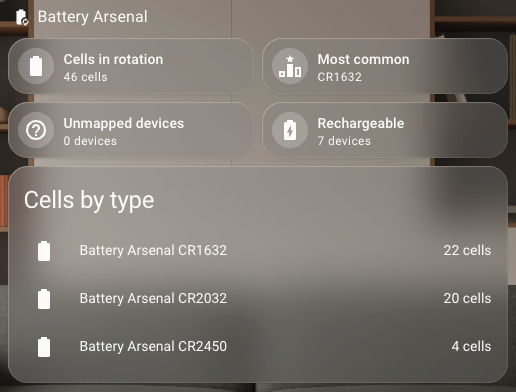
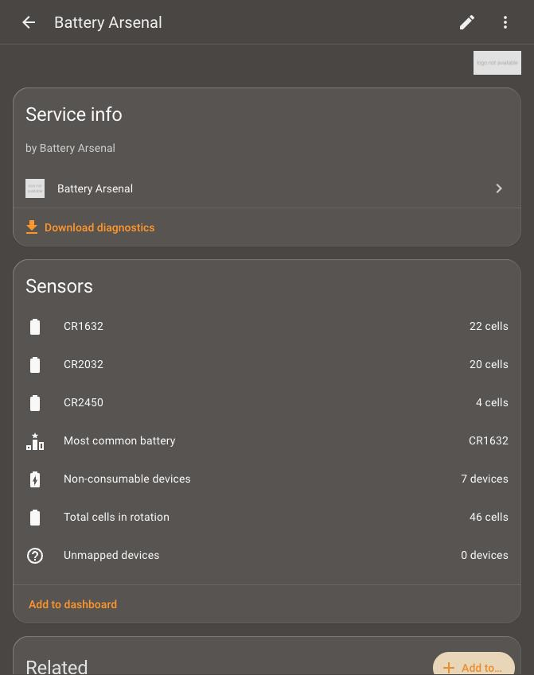

# Battery Arsenal

A Home Assistant custom integration that turns the battery data
[Battery Notes](https://github.com/andrew-codechimp/HA-Battery-Notes) already
knows into a **household battery inventory**: which batteries you need, how many
are in rotation, which types are most common, and — over time — how fast you go
through them.

Battery Arsenal is strictly **read-only** toward Battery Notes. It never imports
Battery Notes' code and never modifies its data; it depends only on the public
entities and events Battery Notes exposes.

> **Requires [Battery Notes](https://github.com/andrew-codechimp/HA-Battery-Notes).**
> Install and set that up first.

## What it does

- Counts every replaceable battery installed in your Home Assistant devices,
  grouped by battery type (AA, CR2032, 9V, …).
- Shows which devices use each type and where they are.
- Surfaces devices with **no known battery type** so you can complete the
  inventory in Battery Notes.
- Keeps rechargeable / built-in batteries out of the shopping totals, but still
  lists them.
- Produces an on-demand **report** (Markdown and CSV) for planning purchases.
- Estimates **replenishment rates** from replacement history as swaps accumulate.

It does **not** monitor battery levels or send low-battery alerts — Battery Notes
and Home Assistant already do that.

## Screenshots

**Dashboard** — summary tiles plus a live "cells by type" breakdown:



**Integration page** — the Battery Arsenal device with its sensors and
downloadable diagnostics:



## Installation (HACS)

Until this is in the HACS default list, add it as a custom repository:

1. In Home Assistant, go to **HACS → ⋮ → Custom repositories**.
2. Add `https://github.com/hexperimental/battery_arsenal` with category
   **Integration**.
3. Install **Battery Arsenal**, then **restart Home Assistant**.
4. Go to **Settings → Devices & Services → Add Integration → Battery Arsenal**.
   - If Battery Notes is not installed/loaded, setup aborts with a message
     telling you to add it first.

## Entities

All entities attach to a single **Battery Arsenal** service device.

### Per-type sensors

One sensor per consumable battery type found, e.g. `sensor.battery_arsenal_aa`.

- **State:** total cells of that type in use.
- **Attributes:** `device_count`, `share_percent`, and a `devices` list (name,
  area, quantity). Once replacement history exists, also
  `estimated_cells_per_year` and `suggested_stock`.

Per-type sensors are created dynamically as types appear. When a type
disappears the sensor goes **unavailable** (not deleted) so history and
dashboards don't break.

### Summary sensors

| Entity | State | Key attributes |
| --- | --- | --- |
| Total cells in rotation | sum of consumable cells | `types`, `devices` |
| Most common battery | type with the most cells | `cells`, `share_percent` |
| Unmapped devices | count of Battery Notes devices with no type | `incomplete_devices` (+ `untracked_devices` in degraded mode) |
| Non-consumable devices | count of rechargeable / built-in devices | `devices` |

## Services

### `battery_arsenal.generate_report`

Builds a report, writes dated files, and returns the report as **response data**
so automations/scripts can use it (e.g. send it as a notification).

| Field | Default | Description |
| --- | --- | --- |
| `format` | `both` | `markdown`, `csv`, or `both` |
| `path` | `battery_arsenal` | Output folder (relative paths resolve inside the config dir; must be an allowed path) |

```yaml
action: battery_arsenal.generate_report
data:
  format: both
response_variable: report
```

### `battery_arsenal.refresh`

Forces an immediate rebuild of the inventory. Mostly for troubleshooting.

## Options

**Settings → Devices & Services → Battery Arsenal → Configure**

- **Report output folder**
- **Non-consumable keywords** (comma-separated; types matching any keyword are
  listed but not counted — default: rechargeable, irreplaceable, built in,
  li-ion, lipo, …)
- **Excluded devices** (left out of all counts and lists)
- **Degraded mode** (off by default — also list battery devices Battery Notes
  does not track, as *untracked*)
- **Restock horizon (months)** — how much stock the suggested level should cover

## Behavior when Battery Notes is missing

- **Setup time:** config flow aborts with a clear message.
- **After setup, if Battery Notes goes away:** Battery Arsenal stays loaded,
  raises a **Repair** issue, and its sensors go **unavailable** rather than
  showing stale zeros. The issue clears automatically — and sensors recover —
  when Battery Notes returns, no restart needed.

## Example dashboard card

```yaml
type: entities
title: Battery Arsenal
entities:
  - sensor.battery_arsenal_total_cells_in_rotation
  - sensor.battery_arsenal_most_common_battery
  - sensor.battery_arsenal_unmapped_devices
  - sensor.battery_arsenal_non_consumable_devices
  - type: section
    label: By type
  - sensor.battery_arsenal_aa
  - sensor.battery_arsenal_aaa
  - sensor.battery_arsenal_cr2032
```

## How it reads Battery Notes

Battery Arsenal reads each device's `sensor.<device>_battery_type` entity
(preferred — it exists for every battery device) and falls back to
`sensor.<device>_battery_plus`. It uses the `battery_type` and `battery_quantity`
attributes, and parses an embedded count such as `2× AA` from the state only as a
fallback. Replacement history (phase 2) is seeded from each
`sensor.<device>_battery_last_replaced` and updated live from the
`battery_notes_battery_replaced` event.

## Development

```bash
pip install -r requirements_test.txt
pytest
```

CI runs `pytest`, Home Assistant **hassfest**, and **HACS** validation.

## License

[MIT](LICENSE). Battery Arsenal uses no Battery Notes code; it relies only on
Battery Notes' public entities and events.
